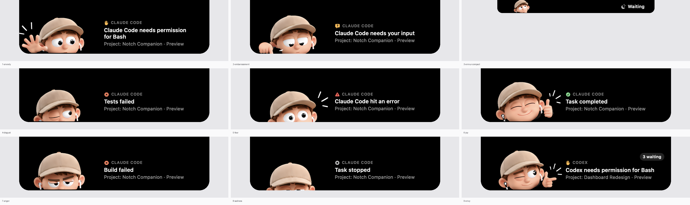
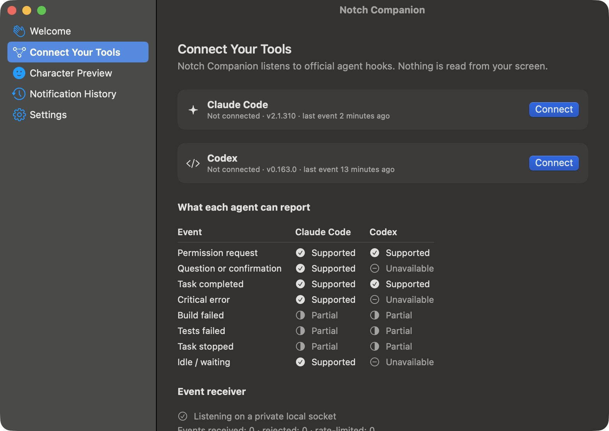
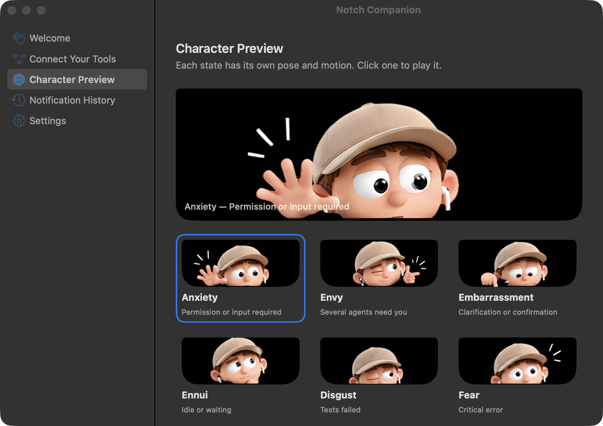
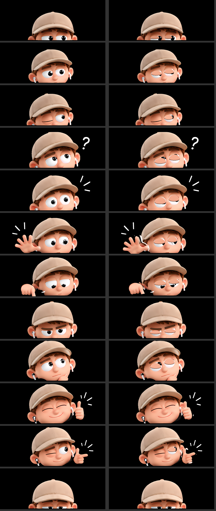

# Notch Companion

**The emotional notification companion for AI coding on macOS.**

When Claude Code or Codex needs your permission, asks a question, fails or finishes, your MacBook's notch opens. A character reacts with one of nine emotions and tells you which agent and project need you. Click it to go back to the source app.



> Native Swift / SwiftUI / AppKit / Core Animation · local-first · no cloud · Apple Silicon · macOS 15+

## Features

- **The notch is the notification.** It grows out of the real hardware notch using the display's own geometry and never covers the camera. Clicks pass through everywhere else. On displays without a notch it falls back to a floating pill.
- **Nine animated emotions.** Each one maps to an event: Anxiety, Envy, Embarrassment, Ennui, Disgust, Fear, Joy, Anger and Sadness. Every emotion has its own pose and motion: pupils that glance and follow your pointer, natural blinks, hand gestures and pop-in effects. The art comes from a Figma storyboard.
- **Real agent integrations.** It uses the official hooks of Claude Code and Codex. A small helper normalises events locally, never writes to stdout and always exits 0, so it can't change an agent's decisions or block it.
- **Smart queueing.**
  - Duplicate reports merge.
  - The highest-priority request shows first.
  - Routine news never hides a blocked agent.
  - Requests resolve when the agent moves on, and expire if the agent dies.
  - Two waiting sessions get a "2 waiting" list.
- **Click to return.** Terminal and iTerm2 open the exact tab; other apps come to the front. It never opens an unrelated session.
- **Calm by design.**
  - Alerts are compact when you're already in the source app.
  - Quiet mode, quiet hours, per-agent and per-category toggles.
  - Optional gentle reminders.
  - Supports Reduced Motion.
  - Uses no CPU when idle.
- **Private.**
  - All processing happens on your Mac.
  - Only metadata leaves the hook: event type, tool name, project folder name and host app. Prompts, code, commands and credentials never do.

| Connect Your Tools | Character Preview |
|---|---|
|  |  |

## Quick start

You need a Mac with Apple Silicon running macOS 15 or later, and Swift 6.2+. Xcode is optional; the Command Line Tools are enough (`xcode-select --install`).

```sh
git clone https://github.com/UX-ankit1514/Mac-Notch-.git
cd Mac-Notch-
Scripts/build-app.sh --install    # builds, copies to ~/Applications, launches
```

On first launch, onboarding walks you through:

1. Choose your agents.
2. **Connect**, after seeing exactly what will change.
3. Send a test notification through the real hook path.
4. Pick basic settings.

After that the app lives in the menu bar as 👀. Press **⌃⌥N** to show the pending requests at any time.

### Connect agents from the command line

```sh
H="$HOME/Library/Application Support/NotchCompanion/bin/notch-hook"
"$H" install claude-code     # merges into ~/.claude/settings.json
"$H" install codex           # merges into ~/.codex/hooks.json (Codex asks you to trust the hooks once)
"$H" status claude-code
"$H" uninstall codex         # removes only Notch Companion's entries
"$H" simulate permission     # sends a test event through the real socket
```

What the installer guarantees:

- Every existing hook and setting is kept, in its original key order.
- A timestamped `*.bak-notch-*` backup is written first.
- Writes are atomic.
- Symlinks are followed, so dotfiles setups keep working.
- A file that isn't valid JSON is never touched.

## How it works

```
agent hook ─▶ notch-hook ─▶ Unix socket ─▶ Notch Companion.app
 (stdin JSON)  normalise locally        │   (0600 socket, 0700 dir, peer-uid check, per-install token)
               no stdout, exit 0         └▶ app not running? → spool/ + wake the app → replayed on launch

app: validate → rate-limit → NotificationManager (dedupe · priority · resolve · expire)
     → EmotionEngine → NotchController → MotionDirector → CharacterRig (Core Animation)
     → NavigationController (click to return)          HistoryStore (SQLite, metadata only)
```

### Event → emotion

| Event | Priority | Emotion | Storyboard pose |
|---|---|---|---|
| Permission request | High | **Anxiety** | Call for Attention |
| Question / plan approval | High | **Embarrassment** | Point / Indicate |
| Idle prompt | Low (compact) | **Ennui** | Thinking |
| Tests failed | Normal | **Disgust** | Blink (squint) |
| Critical error | Critical | **Fear** | Notice Something |
| Task completed | Normal | **Joy** | Happy / Satisfied |
| Build failed | Normal | **Anger** | Serious / Focus |
| Task interrupted | Normal | **Sadness** | Retreat |
| 2+ sessions waiting | — | **Envy** | Playful |

The character rises out of the notch on its "Idle Peek" pose and sinks back on "Retreat".

### What each agent can report

| Event | Claude Code 2.1.310 | Codex 0.163 |
|---|---|---|
| Permission request | ✅ `PermissionRequest`, `Notification` | ✅ `PermissionRequest` |
| Question | ✅ `AskUserQuestion` / `ExitPlanMode`, elicitation | ❌ no hook |
| Task completed | ✅ `Stop` | ✅ `Stop` |
| Critical error | ✅ `StopFailure` | ❌ no hook |
| Build / tests failed | ◐ `PostToolUseFailure`, classified locally | ◐ `PostToolUse` exit code, classified locally |
| Task stopped | ◐ interrupt flag | ◐ `Interrupt` (declared, not yet verified) |
| Idle | ✅ `idle_prompt` | ❌ no hook |

### Click to return

| Host | Level |
|---|---|
| Terminal, iTerm2 | **Exact tab**, matched by tty. macOS asks once for Automation permission. |
| Warp, VS Code, Cursor, others | **App** only. |
| Host closed | "Source closed". It never opens an unrelated session. |

Clicking never marks a request resolved; only the agent moving on does.

## Character art and motion

The character comes from a 12-pose storyboard in Figma. `AssetPipeline/run_pipeline.sh` turns that sheet into an animation rig in one command:

1. Crop the poses onto one aligned canvas.
2. Upscale 4× with Real-ESRGAN, offline. Download the macOS release into `AssetPipeline/vendor/realesrgan/`; the script tells you where to get it.
3. Lift the character off its background with Apple's Vision framework.
4. Cut out separate layers:
   - round pupil sprites
   - skin-toned eyelids with a lash line
   - hands on a wrist pivot
   - tick and "?" effects
5. Write `Resources/Character/rig.json`, plus a QA sheet and the app icon.



| To do this | Do this |
|---|---|
| Ship better art | Replace `AssetPipeline/source/sheet_eb75f1.png` and rerun the pipeline. |
| Use a rendered clip for one emotion | Drop `Resources/Character/clips/<emotion>.mov` (HEVC with alpha) in. No code changes. |

The current art is upscaled from small crops, and mouths and brows are part of each pose rather than animated. [docs/asset-limitations.md](docs/asset-limitations.md) explains this and which replacement assets would remove those limits.

## Testing

| Command | What it does |
|---|---|
| `Scripts/test.sh` | 71 tests, run in debug and release (`-O`). |
| `Scripts/test.sh --quick` | Debug only. |
| `Scripts/qa-notch.sh` | Real hook → socket → notch pass, with a contact sheet. Needs Screen Recording permission for your terminal. |
| `open "build/Notch Companion.app" --args --demo all` | Plays every emotion. Also `envy`, `list`, or an emotion name. |
| `open "build/Notch Companion.app" --args --show character` | Opens a screen directly. Also `tools`, `history`, `settings`. |

Measured on an M4 MacBook:

| Check | Result |
|---|---|
| Hook → notch latency, p95 | 141 ms |
| Idle CPU | 0% |
| Idle memory | 65 MB |
| Burst of 100 events | 100/100 processed |
| Crash recovery | Events spooled and replayed |

Full results, and what still needs a person to verify, are in [docs/test-results.md](docs/test-results.md).

## Project layout

```
Package.swift
Sources/
  NotchCore/          event model, connectors, IPC, notification rules, storage, hook installer (no UI)
  notch-hook/         the CLI agent hooks call
  NotchCompanion/     the app: notch overlay, character rig + motion, menu bar, screens
Tests/NotchCoreTests/ Swift Testing suites + real Claude Code payload fixtures
Resources/Character/  rig layers and rig.json (generated)
AssetPipeline/        Figma export, pipeline scripts
Scripts/              build-app.sh, test.sh, qa-notch.sh
docs/                 test results, asset notes, images
```

## Status

V1 is functionally complete against the product spec: notch, nine emotions, Claude Code and Codex connectors, onboarding, history and settings.

| Item | Status |
|---|---|
| Claude Code hooks | Verified against a real session. |
| Codex hooks | Built to its documented hook format; not yet run against a live session. |
| Clicking back to Terminal/iTerm2 tabs | Needs a manual check. |
| Sleep/wake and multiple displays | Need a manual check. |
| macOS Focus | Unavailable in ad-hoc signed builds. Quiet Mode and Quiet Hours cover it. |
| App signing | Ad-hoc signed; not notarised. |

---

Built with Claude Code. Character design from the project's Figma storyboard.
