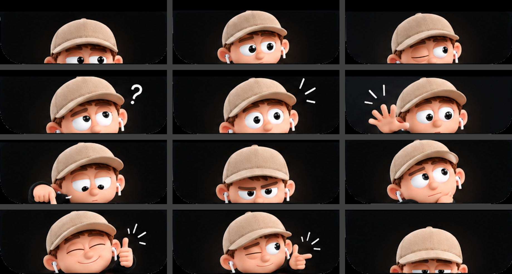

# Character assets: what was done and what's still needed

PRD §9.5 says: "If an asset is insufficient for production, report that limitation and identify the required replacement asset." This document does that.

## Source

- **Figma file:** "Untitled" (`4Gounx7X3nGke6bCdxAolv`) → Page 2 → section **Emotion**.
- **What the 9 rectangles are:** crops of one 1536×1024 image. That image is a labelled 12-pose storyboard: Idle Peek, Look Around, Blink, Curious, Notice Something, Call for Attention, Point / Indicate, Serious / Focus, Thinking, Happy / Satisfied, Playful and Retreat.
- **Other fills:** two hidden fills are earlier versions of the same sheet. They differ only in the top 44 px.
- **Export:** the sheet was exported at native resolution through the Figma Desktop Bridge, using a temporary page that was deleted straight afterwards. `AssetPipeline/source/` holds all three versions.

### Emotion mapping, revised from the storyboard labels

The approved mapping was made from the 9 unlabelled crops. Once the full sheet was exported, the designer's own labels showed three better-fitting poses that the crops had left out:

| Emotion | First mapping (crops) | Shipped | Why |
|---|---|---|---|
| Anxiety | Look Around | **Call for Attention** | Its label is literally "hand comes up to grab attention", and the PRD wants a nervous hand motion. |
| Ennui | Curious | **Thinking** | Its label is "Thinks while waiting". |
| Fear | Idle Peek | **Notice Something** | Its label is "Eyes widen, alert". |
| Envy, Embarrassment, Disgust, Joy, Anger, Sadness | — | unchanged | Playful, Point, Blink, Happy, Serious, Retreat. |

Idle Peek and Retreat now serve as the entry and exit poses, which is what the storyboard describes. Look Around is the neutral fallback.

## Limitation 1: resolution (interim upscale)

- **Problem:** each pose is about 300×116 px in the source, and the character itself is only about 130 px wide. That's too soft for Retina at notch size.
- **What ships:** a 4× upscale made with Real-ESRGAN (`realesrgan-x4plus-anime`, offline) and exported @2x.
- **Trade-off:** edges and identity hold up well, but the cap's fabric texture is smoothed.
- **Replacement needed:** the original renders of the same 12 poses, with **≥ 1024 px per pose, transparent background, same camera and scale**. Drop them into the pipeline and rerun `AssetPipeline/run_pipeline.sh`; nothing else changes.

## Limitation 2: motion is a 2.5D rig, not rigged 3D animation

The renders are flattened, so the motion comes from layers the pipeline cuts out of each pose.

**Animated as separate layers (genuine authored motion):**

| Part | Motion |
|---|---|
| Pupils | Round sprites that move inside an eye-white mask, used for glances and hover look-at. |
| Eyelids | Skin-toned, with a curved lash line. Used for blinks at varied intervals, the angry squint and the slow Ennui blink. |
| Hands | Wave, tap, thumbs-up pump and finger-gun flick, rotating about a wrist pivot. |
| Effects | The storyboard's tick marks and "?" pop in. |
| Head and body | Rise, sink, bounce, recoil, tilt, shake and breathing. |
| Pose changes | Cross-fades between the designer's 12 poses, e.g. Idle Peek → key pose on entry and → Retreat on exit. |

**Not animated:** mouth shapes and eyebrows. Each pose keeps its rendered mouth and brows, and no in-between mouth frames exist. This is **not** rigged 3D facial animation, and the app doesn't claim it is. Its Character Preview screen says so too.

**Replacement needed for full facial animation:** either per-emotion clips (HEVC with alpha, about 1–2 s, looping hold) rendered from a rigged model, or layered source files with mouth, brows, eyes and hands separate. Clips drop in at `Resources/Character/clips/<emotion>.mov` and the player uses them automatically.

*Left: each pose re-assembled from its layers, identical to the source. Right: the same pose with pupils shifted, lids half closed, hand rotated and effects scaled. This proves the layers move independently without holes.*

## Limitation 3: approximate matches

- **Disgust** uses the one-eye squint ("Blink" pose). It reads as skeptical, but there's no nose wrinkle in the art.
- **Sadness** uses "Retreat", the character sinking. There's no drooping-brow pose.

Dedicated renders would make both of these more specific.

## Quality gates (PRD §9.5)

| Gate | Status |
|---|---|
| Identity matches the master | ✅ All poses come from one sheet; eye-centre spacing is 36–41 canvas units across the open-eyed poses (±7%), so no rescaling was needed. |
| Emotion readable without its label | ✅ 7 of 9 clearly. Disgust and Sadness are approximate (see above). |
| No blur at Retina | ⚠️ Acceptable with the upscale; original renders needed for production. |
| No unwanted background | ✅ Vision subject matte; the camera dot and the grey "indicator" bar are removed. |
| No clipping inside the notch | ✅ Verified for all 9 states in the real notch ([screens](images/notch-all-emotions.png)). The character is meant to peek from the notch's lower edge. |
| Eye and mouth motion intentional | ✅ Eyes. Mouth is static (see Limitation 2). |
| Hair and face consistent | ✅ |
| Loops don't jump | ✅ Idle is blink plus breathing (autoreversing). Pulses are additive and end at rest. |
| No stretching or warping | ✅ Only rigid transforms are used, no mesh warps. |
| Smooth on the reference Mac | ✅ M4: Core Animation on the render server; 0% CPU when idle. |
